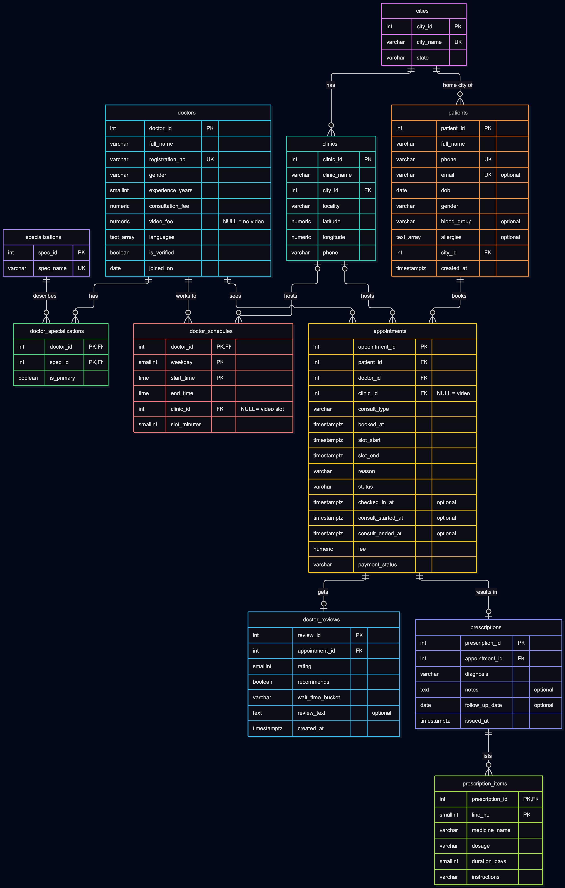

# Phase 2: Schema Design

**Team T0075** · Practo doctor appointments database · PostgreSQL 15+, schema `practo`

The schema has 11 tables. Files: `sql/01_schema.sql` (tables and constraints), `sql/02_load_data.sql` (load), `sql/03_integrity_checks.sql` (cross-table checks), `diagrams/er_diagram.png` and `diagrams/er_diagram.mmd` (ER diagram).

Rules we followed: only PRIMARY KEY, FOREIGN KEY, UNIQUE, NOT NULL and CHECK. No extra indexes. The one partial unique index (`uq_doctor_one_primary_spec`) enforces a business rule, not speed. The database timezone is pinned to Asia/Kolkata so timestamps read the same on every laptop.

## 1. Data dictionary

| Table | Rows | Meaning | Primary key | Why this design |
|---|---:|---|---|---|
| cities | 10 | Cities where patients live and clinics operate | city_id | Small lookup table; city name lives in one place |
| specializations | 15 | Medical specialities | spec_id | Lookup; doctors can have several |
| doctors | 3,000 | Registered doctors with fees and languages | doctor_id | `registration_no` is UNIQUE because the medical council number identifies a real doctor |
| doctor_specializations | 3,700 | Which speciality each doctor practises | (doctor_id, spec_id) | Many-to-many bridge; `is_primary` marks the main one |
| clinics | 1,500 | Physical clinics | clinic_id | `phone` UNIQUE: each clinic has its own number |
| doctor_schedules | 30,499 | Weekly timetable rows | (doctor_id, weekday, start_time) | A doctor cannot start two sessions at the same time on a weekday; NULL `clinic_id` means a video session |
| patients | 40,000 | Registered patients | patient_id | `phone` UNIQUE (sign-in), `email` UNIQUE and optional |
| appointments | 150,000 | Bookings, in-clinic or video | appointment_id | NULL `clinic_id` means video; status and times follow the lifecycle |
| prescriptions | 97,234 | One prescription per completed appointment | prescription_id | `appointment_id` UNIQUE gives the 1:0..1 relationship |
| prescription_items | 243,085 | Medicine lines of a prescription | (prescription_id, line_no) | Weak entity: a line only exists inside a prescription |
| doctor_reviews | 30,339 | One review per completed appointment | review_id | `appointment_id` UNIQUE: a patient reviews a visit once |

Columns that can be empty, and what empty means:

| Column | Empty rows | Meaning of empty |
|---|---:|---|
| doctors.video_fee | 894 | Doctor does not offer video consultations |
| doctor_schedules.clinic_id | 5,899 | Video session, no physical clinic |
| appointments.clinic_id | 27,856 | Video appointment |
| appointments.checked_in_at | 51,180 | Video, cancelled, booked or no-show, or an in-clinic visit with no check-in recorded |
| appointments.consult_started_at / consult_ended_at | 28,591 each | Consultation never happened (not COMPLETED) |
| patients.email | 13,940 | Patient did not give an email |
| patients.blood_group | 3,204 | Not recorded |
| patients.allergies | 33,986 | No allergy recorded (never an empty array) |
| prescriptions.notes | 58,105 | Doctor wrote no notes |
| prescriptions.follow_up_date | 68,184 | No follow-up needed |
| prescription_items.instructions | 97,233 | No extra instruction |
| doctor_reviews.review_text | 12,069 | Rating only |

## 2. Constraints and CHECK rules

Every rule below was tested against the data first (see `scratch` profile results in section 7): none of them rejects an existing row.

| # | Table | CHECK | Reason |
|---|---|---|---|
| 1 | doctors | gender IN ('M','F') | Data contains only these values |
| 2 | doctors | registration_no matches LLLL-dddddd | Fixed council format, all rows match |
| 3 | doctors | experience_years BETWEEN 0 AND 60 | Real range is 1 to 38 |
| 4 | doctors | consultation_fee > 0 and video_fee NULL or > 0 | A fee cannot be zero or negative |
| 5 | doctors | cardinality(languages) > 0 | Every doctor speaks at least one language |
| 6 | clinics | latitude in -90..90, longitude in -180..180 | Valid coordinates |
| 7 | clinics | phone matches +91-dd-ddddddd | One phone format everywhere |
| 8 | doctor_schedules | weekday BETWEEN 1 AND 7 | ISO weekday, data uses 1 to 6 |
| 9 | doctor_schedules | end_time > start_time | A session has positive length |
| 10 | doctor_schedules | slot_minutes BETWEEN 5 AND 60 | Data uses 10, 15, 20 |
| 11 | patients | phone is 10 digits | Sign-in key format |
| 12 | patients | email lower case and shaped x@y.zz | Prevents duplicates differing only by case |
| 13 | patients | gender IN ('M','F','X') | Data values |
| 14 | patients | blood_group in the 8 valid groups | Domain list |
| 15 | patients | allergies NULL or non-empty array | No ambiguous empty array |
| 16 | patients | dob between 1900 and created_at date | A patient is born before registering |
| 17 | appointments | consult_type IN ('IN_CLINIC','VIDEO') | Domain |
| 18 | appointments | status IN BOOKED, COMPLETED, CANCELLED, NO_SHOW | Domain |
| 19 | appointments | payment_status IN PAID, PENDING, REFUNDED | Domain |
| 20 | appointments | IN_CLINIC needs clinic_id, VIDEO needs NULL clinic_id | Matches 122,144 and 27,856 rows exactly |
| 21 | appointments | slot_end > slot_start, booked_at <= slot_start | Time order |
| 22 | appointments | consult_ended_at >= consult_started_at when both exist | Time order |
| 23 | appointments | COMPLETED needs start and end times; other statuses have no check-in, start or end | Lifecycle rule |
| 24 | appointments | VIDEO has no checked_in_at | Nobody checks in at a clinic for video |
| 25 | appointments | REFUNDED only when CANCELLED | Refunds only follow cancellation |
| 26 | appointments | BOOKED implies PENDING | Unpaid until the visit |
| 27 | appointments | fee >= 0 | Money cannot be negative |
| 28 | prescriptions | follow_up_date not before issue date | Follow-up is in the future |
| 29 | prescription_items | dosage matches d-d-d, duration_days > 0, line_no > 0 | Format and range |
| 30 | doctor_reviews | rating BETWEEN 1 AND 5 | Star scale |
| 31 | doctor_reviews | wait_time_bucket in the 4 allowed buckets | Domain |

Delete behaviour: deleting a doctor removes that doctor's specialization and schedule rows; deleting a prescription removes its items. Everything else uses the default (blocked while referenced), so clinical history is never lost silently.

## 3. Relationships

| Parent | Child | Cardinality | Foreign key |
|---|---|---|---|
| cities | clinics | 1 : many | clinics.city_id |
| cities | patients | 1 : many | patients.city_id |
| doctors | doctor_specializations | 1 : many | doctor_id |
| specializations | doctor_specializations | 1 : many | spec_id |
| doctors | doctor_schedules | 1 : many | doctor_id |
| clinics | doctor_schedules | 1 : many (optional) | clinic_id, NULL for video |
| patients | appointments | 1 : many | patient_id |
| doctors | appointments | 1 : many | doctor_id |
| clinics | appointments | 1 : many (optional) | clinic_id, NULL for video |
| appointments | prescriptions | 1 : 0..1 | appointment_id UNIQUE |
| prescriptions | prescription_items | 1 : many | prescription_id |
| appointments | doctor_reviews | 1 : 0..1 | appointment_id UNIQUE |

Doctors and specializations are many-to-many through `doctor_specializations`. Exactly one row per doctor has `is_primary = true`, enforced by the partial unique index `uq_doctor_one_primary_spec`; the data has 3,000 primary rows for 3,000 doctors.

## 4. ER diagram

Mermaid source: `diagrams/er_diagram.mmd`.